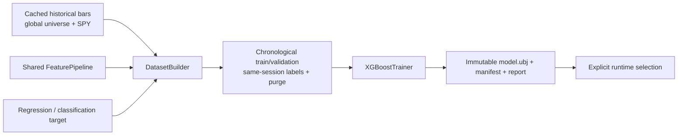

# Carcharoth Architecture

Carcharoth is a model-driven, interface-first intraday trading system. Concrete adapters are
wired only in `main.py`; the engine passes domain types through a fixed sequence.

## Runtime flow

```mermaid
flowchart LR
  S[Scheduler / BacktestRunner] --> E[TradingEngine]
  E --> M[MarketDataService]
  M --> X[Completed bars + quotes<br/>tradables + SPY]
  X --> G[ModelSignalGenerator]
  G --> F[FeaturePipeline]
  F --> P[XGBoostPredictor]
  P --> D[DecisionPolicy]
  D --> I[LONG / SHORT / FLAT / UNCHANGED]
  I --> R[RiskManager]
  R --> O[OrderExecutor]
```

Each tick reconciles fills, obtains one snapshot/account state, saves the account snapshot, then
isolates decision/risk/order errors per tradable symbol. Context symbols are fetched but never
added to the trading loop or replay grid.

`ModelSignalGenerator` is the engine seam. It owns feature construction, artifact-backed
prediction, task-specific decisioning, one-evaluation-per-completed-bar state, and session safety.
The engine knows nothing about XGBoost or feature names.

## Training flow

The regression label is next-bar open to `horizon`-bar close. Classification derives
SHORT/FLAT/LONG from that same return and a neutral band. No random row split or cross-session
label is allowed. Backtest/quicktest windows must start after validation.

The artifact manifest is the contract between training and runtime: ordered feature descriptors
and implementation versions, schema/model hashes, task/target, horizon, timeframe, benchmark,
universe, parameters, seed, versions, date windows, metrics, and row counts.

## Important modules

- `features/`: pure scalar features and ordered/versioned `FeaturePipeline`.
- `modeling/`: datasets, diagnostics, artifact validation, decision policy, deep runtime module,
  and offline orchestration.
- `services/xgboost/`: the only native XGBoost adapter.
- `engine/`: orchestration/fill reconciliation/order-conflict handling only.
- `risk/`: signed target transitions, sizing, absolute gross exposure, close-first reversal.
- `services/backtest/`: queued order at bar `t`, fill at `t+1` open, mark at close, signed margin
  accounting.
- `quicktest/`: independent per-symbol fixed-artifact simulation with SPY context.
- `analysis/`: long/short FIFO matching and common metrics.
- `services/optuna/`: fixed-artifact decision/risk search; retraining-required paths are rejected.
- `regime/`: detector source retained but disconnected from all runtime construction.

## Persistence

Every PAPER/BACKTEST/QUICKTEST run owns its model decisions, orders, trades, snapshots, round
trips, and metrics through `run_id`. `model_decisions` store artifact/schema IDs, raw prediction,
target exposure, configured feature values, and risk result. `round_trips` store direction,
model ID, entry/exit prediction/features, P&L, and excursions.

## Extension seams

- Broker/data/clock/execution interfaces have live and replay/test adapters.
- `ModelSignalGenerator` has production XGBoost and in-memory test adapters.
- Feature and target registries are internal seams shared by training and inference.
- `ParameterOptimizer` isolates Optuna from backtest logic.
- Repositories isolate Postgres from domain/engine logic.

Do not add a strategy fallback, runtime regime router, random split, same-close replay fill, or an
artifact auto-activation path.
