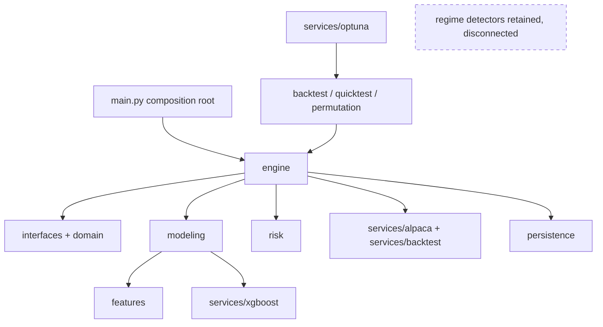

# Module Overview

Training and runtime share `FeaturePipeline`; runtime never builds labels and training never
places orders. Provider SDK types stay in provider adapters. See `../architecture.md` for the
complete contracts and invariants.
