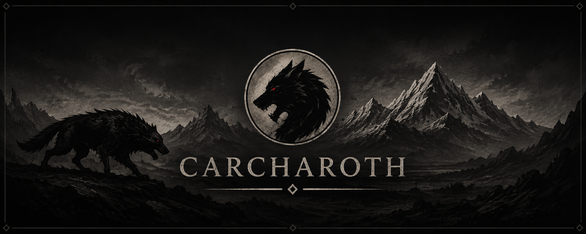

# Carcharoth

Model-driven intraday stock trading and research platform. Live execution uses an Alpaca paper
account; training, quicktests, backtests, permutation tests, and Optuna studies reuse the same
feature schema and immutable XGBoost artifacts.

> Paper trading and experimentation only. This is not financial advice.

## Architecture

```text
Scheduler / BacktestRunner
  -> TradingEngine.tick()
     0. reconcile fills
     1. MarketDataService: completed bars + quotes for tradable symbols and SPY context
     2. AccountService: equity, buying power, signed positions
     3. ModelSignalGenerator
          FeaturePipeline -> XGBoostPredictor -> DecisionPolicy
          LONG | SHORT | FLAT | UNCHANGED
     4. RiskManager: validate and size the target transition
     5. OrderExecutor: submit the approved order
```

The engine only orchestrates typed modules. Live and replay differ through injected market-data,
account, and execution adapters. An order decided from completed bar `t` fills at the next bar's
open in replay; live submits a market order after the completed bar. Reversals close first and
open the opposite direction only after the account confirms flat. Intraday safety always flattens
before the close.

Offline training is deliberately separate:

```text
Historical BarsFetcher (global universe + SPY)
  -> shared FeaturePipeline
  +  regression/classification TargetBuilder
  -> chronological train/validation datasets
  -> XGBoostTrainer
  -> artifacts/models/<id>/{model.ubj,manifest.json,report.json}
```

Artifacts are immutable and never activated automatically. Set `model.artifact_path` in a
research profile, verify it out of sample, then promote that config leaf to `trading/paper`.
The old rule-based strategies and regime routing do not exist. Regime-detector source remains
disconnected under `src/carcharoth/regime/` for possible future model context.

## Initial features

The ordered feature list lives in `config/base.yaml`; changing it changes the schema hash and
requires retraining.

- momentum: 1/5/20/60-bar log returns
- trend: 20/60-bar EMA distance and ADX(14)
- volatility: normalized ATR(14), 20/60-bar realized volatility
- price position: normalized RSI(14), 20-bar range position, session VWAP distance
- volume: same-time-of-day log-volume z-score over 20 prior sessions
- context: SPY 5/20-bar returns and cyclical time-of-day

Features are scale-free and do not include symbol IDs, regime, raw prices, or quote fields that
cannot be reproduced from historical bars. `report.json` records constant/high-correlation
checks, prediction-versus-actual samples, prediction deciles and distributions, and gain plus
validation permutation importance. Successful training also publishes this bounded report to the
**Model Diagnostics** Grafana dashboard; a database failure only emits a warning because the
artifact-local report remains authoritative.

Feature importance measures association, not causal impact. Correlated features can split or
dilute both gain and permutation importance. These diagnostics use the chronological validation
window, so repeatedly tuning against them overfits that window; confirm changes on a later,
strictly out-of-sample quicktest or backtest.

## Setup

Requirements: [uv](https://docs.astral.sh/uv/), Docker, and on macOS the OpenMP runtime used by
XGBoost.

```bash
brew install libomp              # macOS only
uv sync
cp .env.example .env             # add Alpaca paper credentials
docker compose up -d
uv run alembic upgrade head
```

## Workflow

```bash
# 1. Train a global regression artifact. Date ranges come from the profile.
uv run carcharoth train -p training

# Optional date overrides; all are recorded in config provenance.
uv run carcharoth train -p training \
  --train-start 2023-01-01 --train-end 2024-06-30 \
  --validation-start 2024-07-01 --validation-end 2024-12-31

# 2. Explicitly select the printed artifact for an out-of-sample research run.
uv run carcharoth quicktest --set model.artifact_path=artifacts/models/<id>
uv run carcharoth backtest --set model.artifact_path=artifacts/models/<id>

# 3. Optimize decision thresholds/risk without retraining the artifact.
uv run carcharoth optimize --set model.artifact_path=artifacts/models/<id>

# 4. After review, use the TUI Promote screen to promote model.artifact_path.
cargo run -p carcharoth-tui
uv run carcharoth run            # Alpaca paper trading
```

A backtest/quicktest window must start strictly after the artifact's validation window. Runtime
rejects missing/corrupt artifacts, model hashes, task/schema/config mismatches, and in-sample
windows.

### Frozen universe grouping

Universe discovery is a manual offline preprocessing step, never an application-startup task:

```bash
uv run carcharoth universe discover --config config/universe-discovery.yaml
uv run carcharoth universe discover --config config/universe-discovery.yaml \
  --reuse-data artifacts/universes/<id>
```

The command ranks currently listed Alpaca US equities (stocks and ETFs) by mean daily
`close × volume`, computes six long-window statistical descriptors, and uses deterministic
complete-linkage clustering. Lower `distance_threshold` values create tighter, usually smaller
buckets; clusters below `min_bucket_size` remain diagnostic-only. The reserved `all` bucket is
the pooled baseline. `--reuse-data` verifies saved checksums and reclusters without credentials
or network access.

Each run atomically publishes immutable source data, membership, features, and diagnostics under
`artifacts/universes/`. Alpaca's asset catalogue is current rather than point-in-time, so
historical snapshots are explicitly **survivorship-biased**. SIP access is attempted as
configured and never silently downgraded; selecting IEX means ranking by exchange-only volume.

Select a frozen bucket in a research profile or on the CLI:

```bash
uv run carcharoth train -p training \
  --set universe.snapshot=artifacts/universes/<id>/buckets.yaml \
  --set universe.bucket=bucket-001
```

Bucket membership replaces inherited `symbols` during config resolution and is embedded with its
hash in stored configs and model artifacts. Discovery must end before training starts. Compare a
bucket-trained model with a pooled (`all`) model on the same later bucket/window; do not combine
per-bucket portfolio returns as one capital-constrained portfolio.

### Training data eligibility

Training screens **both** splits before fitting, for explicit symbol lists as well as frozen
buckets. By default, a symbol failing either split is dropped from **both** datasets. The
requested config/snapshot stays immutable; `manifest.json` records `effective_symbols`
separately. This is a global model: a training exclusion does not prohibit later inference.

Defaults in `training.eligibility`:

| Setting | Default |
|---|---:|
| `mode` | `drop` (`strict` rejects the whole attempt on any exclusion) |
| `min_train_rows` / `min_validation_rows` | 100 / 30 usable rows per symbol |
| `min_usable_coverage` | 0.80 in each split |
| `min_symbols` / `min_retained_fraction` | 1 / 0.50 |

The retained count must reach `max(min_symbols, ceil(requested_count * min_retained_fraction))`.
These are operational floors, **not statistical guarantees**. Coverage compares usable rows
with exchange-scheduled target opportunities, accounting for feature warmup, target horizon,
split boundaries, holidays, early closes and DST. Target paths with missing intraday intervals
are rejected rather than stretching the horizon. Invalid OHLCV/conflicting duplicates exclude
a symbol; missing required benchmark data is a global failure. A successful exchange calendar
request is required for training; there is no weekday-only fallback.

```bash
# Fail rather than drop any ticker:
uv run carcharoth train --set training.eligibility.mode=strict
# Raise coverage or the retained cohort floor:
uv run carcharoth train --set training.eligibility.min_usable_coverage=0.95 \
  --set training.eligibility.min_retained_fraction=0.8
# Optional report-only backtest check (also available through backtest-loop --set):
uv run carcharoth backtest --set backtest.check_data_coverage=true
```

Every training assessment has a UUID and an atomic local report at
`<training.artifact_root>/_assessments/<uuid>.json`, including rejected attempts and fetch/fit
errors. Successful artifacts also embed eligibility in `report.json`. Logs show excluded
symbols, reasons and observed/required values. PostgreSQL publication is best-effort: a DB
outage leaves the local report and warns, without invalidating a valid model. A pre-fit local
audit-write failure blocks fitting. Apply `uv run alembic upgrade head` to provision
`data_eligibility_assessments`; the **Data Eligibility** Grafana dashboard shows success,
exclusions, strict rejection, shared-context errors and unknown reference-data status.
Model Diagnostics, Backtest Results and Backtest Loops link to it. Models without an assessment
are **not assessed**, not evidence of zero exclusions.

Backtest checks are off by default and add feature-computation/calendar overhead when enabled.
They write `logs/backtests/<run_id>.eligibility.json`, report feature readiness without future
labels, and **never** alter replay membership, positions, trades or training selection. Missing
backtest data can compromise results; this check is not delisting-return handling.

We have no point-in-time security master/corporate-action feed: listing/action status remains
`unknown/not_available`, never a guessed delisting or merger. No current-active catalogue filter,
forward filling, automatic ticker stitching, or new data adjustment/cache semantics are applied.
Missing history is evidence of missing history only. Validation-availability selection itself
conditions the training cohort; do not interpret it as a survivorship-unbiased historical universe.
Each loop iteration assesses independently and keeps its own linked audit trail.

### Backtest loops

Apply `uv run alembic upgrade head` before using loop grouping. In the Rust TUI, open
**Backtest Loop**: **F2** refreshes model/universe artifacts, **F3** validates and previews
all windows, and **Enter** confirms Start. Choose the universe artifact first, then its
bucket. **PgUp/PgDn** scroll the preview; Output shows progress and **x** cancels the loop.

Set the iteration count and backtest period (quarterly / half-year / yearly). Training is
opt-in: set its original start, **initial** training period, and validation period. Training
expands by one backtest period per iteration; validation and backtest keep their durations.
Each iteration trains a fresh model and backtests that exact artifact. With training off,
select an existing model and backtest start date instead; all iterations reuse that model.
Every backtest starts with fresh capital and positions. Prepared history is a separate,
explicit toggle (off by default in loops, even if the profile enables it).

The same workflow is available without the TUI:

```bash
uv run carcharoth backtest-loop --iterations 4 --label quarterly-research \
  --train --train-start 2020-01-01 --train-period yearly \
  --validation-period quarterly --backtest-period quarterly \
  --snapshot artifacts/universes/<id>/buckets.yaml --bucket all \
  --prepared-history false --dry-run --json
# Remove --dry-run --json to execute.

uv run carcharoth backtest-loop --iterations 4 --label fixed-model \
  --artifact artifacts/models/<id> --start 2025-01-01 --backtest-period quarterly \
  --snapshot artifacts/universes/<id>/buckets.yaml --bucket bucket-001 \
  --prepared-history true --dry-run --json
```

Periods are 3/6/12 calendar months from the chosen start (month-end days are clamped without
cumulative drift). All backtests must finish before today UTC. The first error stops the loop;
completed artifacts/results remain available, but there is no automatic retry or resume.
Cancellation kills the entire child process tree; an interrupted run can remain unfinished.

The provisioned **Backtest Loops** Grafana dashboard groups runs by a separate loop UUID and
optional label, with per-iteration metrics, independent equity series and links to run/model
and performance details. Run UUIDs remain unchanged. It does not compound independent runs;
training-only failures appear in Output, not as fabricated backtest rows.

## CLI

| Command | Purpose |
|---|---|
| `carcharoth train` | Build and publish an immutable global XGBoost artifact |
| `carcharoth run` | Live Alpaca paper trading with an explicitly selected artifact |
| `carcharoth quicktest` | Fast per-symbol, fixed-artifact long/short simulation |
| `carcharoth backtest` | Replay the full engine, risk, signed broker, and next-open fills |
| `carcharoth backtest-loop` | Repeat independent backtests with optional expanding-window training |
| `carcharoth optimize` | Optuna search over fixed-artifact decision/risk settings |
| `carcharoth universe discover` | Manually rank and group an immutable Alpaca universe |
| `carcharoth universe list --json` | List validated local universe snapshots and their buckets |
| `carcharoth quicktest --permute [METHOD]` | Bar permutation or trade Monte Carlo |
| `carcharoth backtest --permute [METHOD]` | Trade-based Monte Carlo on a finished run |
| `carcharoth analyze --run-id UUID` | Recompute metrics and signed FIFO round trips |
| `carcharoth config ...` | List, resolve, validate, diff, hash, or emit schema |
| `carcharoth cache stats\|clear` | Inspect or clear cached historical bars |

The Rust TUI is a front-end only. It invokes `uv run carcharoth ...`, edits temporary `--set`
overrides, and promotes selected leaves into `config/generated/paper-promoted.yaml`.

## Configuration

`config/base.yaml` owns the strict structure. Profiles recursively extend layers; mappings
merge, lists replace, and later layers win. `model.target` and `optimization.search_space` are
atomic mappings. Every run stores the validated config, content hash, and provenance.

Important sections:

- `model`: artifact path, timeframe, benchmark, ordered features, regression/classification
  target, decision thresholds/session policy, and XGBoost parameters
- `training`: chronological train/validation dates, artifact root, seed, early stopping
- `data`: out-of-sample quicktest/backtest/Optuna window
- `risk`: symmetric position sizing, gross-exposure, buying-power, position-count, daily loss
- `backtest`: initial capital, margin multiplier, synthetic spread/slippage
- `optimization`: fixed-artifact threshold/risk search space and constraints
- `universe`: optional immutable snapshot and bucket selector; resolved metadata is read-only

Optuna rejects search paths under features, target, timeframe, benchmark, XGBoost parameters,
artifact path, or training config because those require a retrained artifact.

### P0 research controls

`--set model.prepared_history=true` computes one causal batch per target before replay,
quicktest or each bar permutation. It is **opt-in**: recursive initialization can differ
from rolling live history. Artifacts/feature versions are unchanged; no automatic retraining
or default promotion is allowed. See [P0 status and gates](plans/backtest-p0-results.md).

Historical caching now uses UTC monthly Arrow/Zstandard chunks with embedded fetched coverage.
v1 pickle keys are neither read nor migrated. `cache clear --bars-version v2` (the default)
clears only v2; `v1` or `all` requires deliberate selection. `--set cache.bars=false` bypasses
storage. Today's UTC tail is always fetched fresh. Redis stats label server-wide memory.

## Persistence and monitoring

PostgreSQL stores run-scoped `model_decisions`, orders, fills, signed position/equity snapshots,
long/short `round_trips`, metrics, and permutation results. Slim backtests omit high-volume model
features unless `--verbose-db` is used. Grafana dashboards live under
`grafana/provisioning/dashboards/`.

Backtests also produce bounded stage/CPU summaries in
`logs/backtests/<execution-id>.performance.json` and the **Backtest Performance** dashboard.
After `uv run alembic upgrade head`, backtests publish periodic cumulative updates every
10 seconds by default. Use `--performance-interval 0` for final-only reporting, or `--no-performance`
for a baseline. Slow/failed telemetry writes disable periodic publication without failing
research. `--profile-output logs/replay.pstats` enables more expensive, replay-only cProfile.
See [the performance runbook](.claude/backtest-performance.md) for interpreting nested timings,
profiling limitations, and matched overhead comparisons. No Prometheus deployment is needed.

## Development

```bash
uv run pytest
uv run ruff check
uv run ruff format --check
uv run mypy src
cargo fmt --all --check
cargo clippy --workspace --all-targets -- -D warnings
cargo test --workspace
```

See `.claude/architecture.md` and `.claude/` for module and workflow details.
